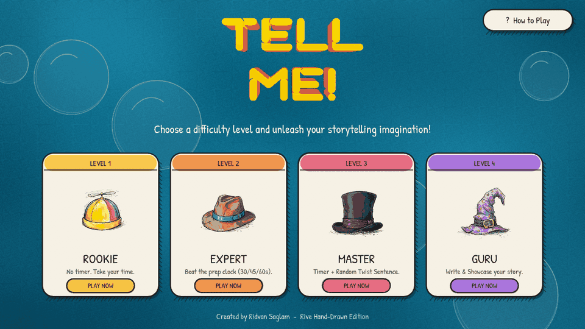
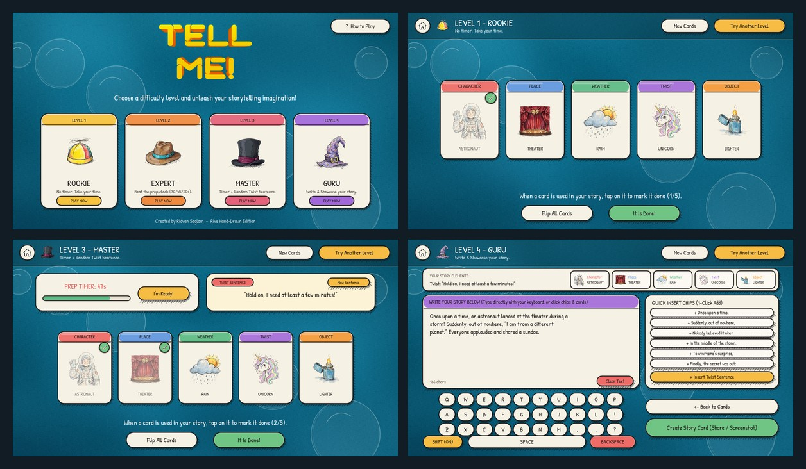

# 🎴 Tell Me! — A Storytelling Card Game

[](https://rive.app)
[](https://luau.org)
[](#)
[](#)
[](#license)

An interactive, responsive storytelling card game built **100% natively in Rive & Luau**, featuring a hand-drawn sketchbook & watercolor aesthetic, procedural 2D canvas graphics, and a dual-tier input system (physical keyboard + on-screen chips).



---

## 📖 The Story Behind the Project / Projenin Hikayesi

This project originally began as an **Articulate Storyline e-learning challenge** (`Tell me your story`). While the original Storyline version demonstrated the concept well, it was constrained by legacy slide-based mechanics, fixed dimensions, and bulky output packages.

We reimagined and rebuilt the entire experience from the ground up as a **pure native Rive application**:
- 🚀 **Zero Heavyweight LMS / Runtime Overhead:** Entire game logic, state machines, particle systems, and vector drawing run locally at 60+ FPS inside a single Rive artboard.
- 🎨 **Art Direction Shift:** Replaced flat generic vectors with **72 cohesive, hand-crafted watercolor & ink illustrations** (4 difficulty hats + 68 deck items).
- 📐 **Full-Bleed Responsive Canvas:** Dynamically scales to any monitor ratio (16:9, ultrawide, mobile portrait/landscape) without black pillarbox bars.
- ⌨️ **Physical Keyboard & Touch Dual-Input:** Full support for standard typing, backspacing, Turkish/international character sets (`ç, ğ, ı, ö, ş, ü, İ`), and 1-click chip shortcuts.

---

## 🎮 Game Anatomy & 4 Difficulty Levels

The game challenges players to draw 5 random cards across distinct categories and weave them into a coherent, imaginative tale:



### 1. 🧢 Level 1: Rookie
- **Pacing:** Relaxed & untimed.
- **Mechanics:** Tap to flip cards one-by-one or click *"Flip All Cards"*. As you speak or write each element into your story, tap the card to mark it with a lively green checkmark badge.

### 2. ⏱️ Level 2: Expert
- **Pacing:** Fast & exciting (30-second countdown clock).
- **Mechanics:** A custom circular progress timer counts down in real time. Can you incorporate all 5 cards before the buzzer rings and confetti bursts?

### 3. 🎩 Level 3: Master
- **Pacing:** Timed with an unpredictable twist.
- **Mechanics:** In addition to the 5 cards, an animated wax-sealed envelope reveals a **Mystery Twist Sentence** (e.g. *"I am from a different planet."*, *"Hold on, I need at least a few minutes!"*) that must be logically woven into your plot.

### 4. 🧙 Level 4: Guru (The Creative Writing Studio)
- **Interactive Story Editor:** Compose your story directly inside the game!
- **Hardware Keyboard Support:** Type naturally using your computer's physical keyboard with real-time cursor blinking, UTF-8 safety, and backspace handling.
- **1-Click Quick Chips:**
  - **Card Chips:** Click any of the 5 cards at the top to instantly insert its noun (e.g., clicking the Astronaut card types `astronaut `).
  - **Story Starters:** 1-click openings (*"Once upon a time, "*, *"Suddenly, out of nowhere, "*).
  - **+ Insert Twist Sentence:** Injects the mystery quote with quotation marks in a single click.
- **Shareable Story Card:** Generates a clean, beautifully formatted showcase card with your level title, cards used, completed story, and timestamp ready for screenshots or sharing.

---

## 🎨 Visual Assets & Art Direction

The visual style blends **delicate ink linework, subtle paper grain, and soft watercolor washes**:

| Category | Count | Example Cards Included |
|---|:---:|---|
| **Character** | 16 | Astronaut, Alien, Scientist, Wizard, Thief, Boss, Singer, Student, Detective |
| **Place** | 10 | Theater Scene, Bank Vault, Stadium, Castle, Beach, Urban Park, Government HQ |
| **Weather** | 12 | Rain Shower, Thunderstorm, Sunshine, Earthquake, Tsunami, Dust Storm, War |
| **Twist** | 10 | Unicorn, Fortune Telling, Voodoo, Mutation, Crocodile, Scorpion, Tent |
| **Object** | 20 | Lighter, Potion, Scissors, Sewing Machine, Sundae, Mat, Evidence, Tools |
| **Level Badges** | 4 | Propeller Beanie (Rookie), Sport Cap (Expert), Top Hat (Master), Wizard Hat (Guru) |

All 72 images have been dynamically background-cleared (eliminating grey halos), auto-cropped, and optimized with bicubic/Lanczos sampling down to a compact 6.8 MB bundle.

---

## 🛠️ Architecture & Tech Stack

```
tell_me_story/
├── scene.rml              # Declarative RML tree: Artboard, StateMachine, FocusData, and Assets
├── main.luau              # Core game loop: UI renderer, input dispatch, particle physics & timer
├── cards_data.luau        # Structured metadata catalog for all 68 cards across 5 categories
├── assets/                # README showcase visuals (GIF walkthrough, feature grid, screenshots)
│   ├── gameplay_walkthrough.gif
│   ├── features_grid.jpg
│   └── screens/
├── img/                   # Production-optimized PNG sprites & UI assets
├── tools/                 # Build & QA automation pipeline
│   ├── shots.py           # Automated 8-screen headless QA screenshot runner
│   ├── optimize_assets.py # Adaptive 4-corner alpha extraction & image compression
│   └── build_github_assets.py
├── index.html             # Standalone Web preview template (GitHub Pages ready)
└── rive.yaml              # Project configuration for Rive CLI
```

### Key Technical Highlights
1. **Procedural Sketchbook Renderer:** Rather than relying on static background bitmaps, borders and buttons use hand-drawn jitter curves (`drawSketchBox`), dynamic paper drop shadows, and responsive gouache bars drawn via Luau `Renderer:drawPath`.
2. **Dual-Tier Keyboard Architecture:**
   - `textEvent`: Captures raw character input from OS IME and international keyboard layouts.
   - `keyboardEvent`: Intercepts `Backspace (259)`, `Enter (257)`, and `Escape (256)` with safe UTF-8 byte boundary traversal.
3. **Adaptive Cover Scaling:** Detects viewport dimensions (`winW`, `winH`) and scales the background seamlessly without letterboxing or pillarboxing.

---

## 🚀 Getting Started

### Prerequisites
Make sure you have the [Rive CLI](https://rive.app/docs) installed:
```bash
# Verify installation
rive --version
```

### Running Locally
To launch the live interactive preview with hot-reload:
```bash
# Clone the repository
git clone https://github.com/ridvanbsaglam/tell_me_story.git
cd tell_me_story

# Start Rive desktop preview
rive .
```

### Headless Verification & QA Testing
```bash
# Compile and verify with strict Luau type-checking (0 errors, 0 warnings)
rive . --verify

# Run headless QA capture of all 8 screens
python tools/shots.py
```

---

## 🌐 Web Deployment (GitHub Pages)

The repository includes a standalone `index.html` configured for `@rive-app/canvas`. 

To host on **GitHub Pages**:
1. Push your repository to GitHub.
2. Go to **Settings > Pages**.
3. Under **Branch**, select `main` and `/ (root)`.
4. Your interactive game will be live at `https://<your-username>.github.io/tell_me_story/` with zero developer HUD bars and edge-to-edge responsiveness!

---

## 📄 License

Distributed under the **MIT License**. See `LICENSE` for more information.

---

*Crafted with passion using Rive & Luau.*
